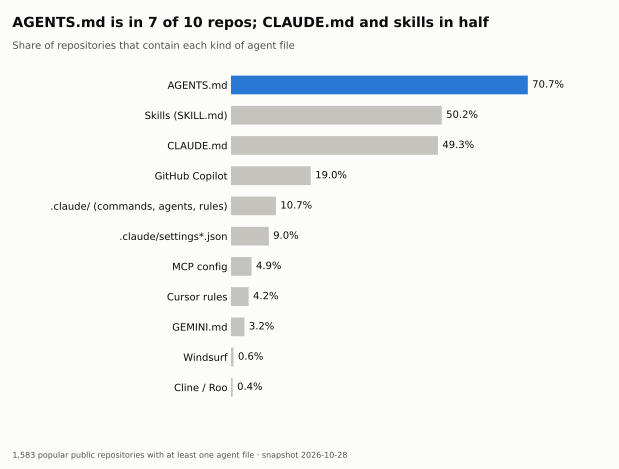
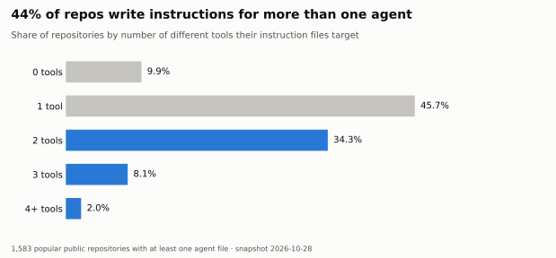
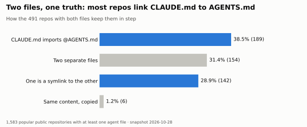
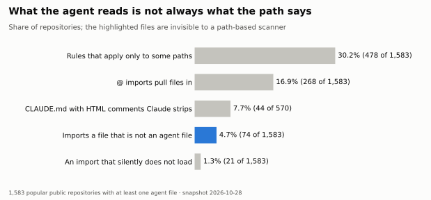
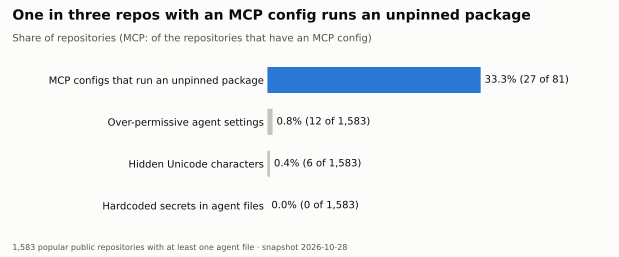
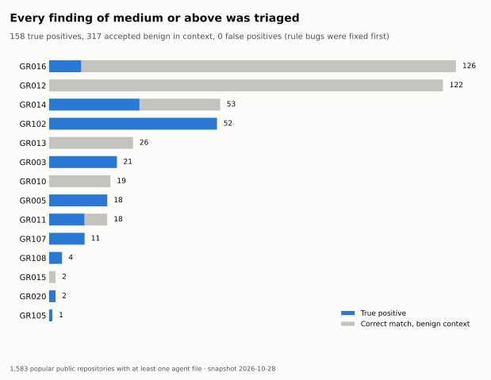

# A snapshot (2026-10-28) of what 1,583 popular repos tell their AI agents

*One day, one scan, popular open-source repositories that have agent files. Not a trend and not a
sample of all software.*

We scanned the agent files of 1,583 popular public repositories with
[ghostrules](https://github.com/BardLaudian/ghostrules): `AGENTS.md`, `CLAUDE.md`, Cursor and Copilot
rules, skills, MCP configs and agent settings. Aggregates only: no repository is named next to a
finding, and every number below comes from the CSVs in [`data/`](data/).

## In short

**Security indicators** (what a reviewer cannot easily see, or what executes things)

- **33.3% (27 of 81)** of the repos that configure an MCP server start at least one with an
  unpinned `npx` or `uvx` package. The denominator is a lower bound (see "MCP denominator" under
  Limitations), so this share is an upper bound.
- **Hidden Unicode: 0.4% (6 of 1,583).** All characters that really are in the text; none carries
  a payload.
- **Over-permissive agent settings: 0.8% (12 of 1,583).**
- **Hardcoded secrets: 0.0% (0 of 1,583).** Private disclosures sent: 0. No real malicious instruction
  was found among the findings of medium severity or above that one maintainer reviewed.
- **Reliability:** of the 475 findings of medium severity or above, 33% (158 of 475) were
  true positives; the rest matched something harmless in context and are noise for a user (section 5).

**How people write agent files** (hygiene, not security)

- **`AGENTS.md` is the shared language.** It is in 70.7% (1,119 of 1,583) of repos,
  ahead of skills (50.2% (794 of 1,583)) and `CLAUDE.md`
  (49.3% (781 of 1,583)).
- **44.4% (703 of 1,583) write instructions for more than one tool**, and the repos that keep `CLAUDE.md`
  and `AGENTS.md` together mostly link them (38.5% (189 of 491) import one from the other,
  28.9% (142 of 491) use a symlink) instead of copying.
- **What an agent reads is not just what its path says.** 16.9% (268 of 1,583) use `@` imports,
  30.2% (478 of 1,583) have rules that apply only to some paths, and 4.7% (74 of 1,583)
  import a file that is not an agent file at all.

## 1. Who writes instructions for agents

<picture>
  <source media="(prefers-color-scheme: dark)" srcset="charts/01-adoption-dark.svg">
  
</picture>

| File | Repos | % of repos | Files |
|---|---|---|---|
| AGENTS.md | 1,119 | 70.7 | 3,351 |
| Skills (SKILL.md) | 794 | 50.2 | 20,359 |
| CLAUDE.md | 781 | 49.3 | 1,824 |
| GitHub Copilot | 301 | 19.0 | 565 |
| .claude/ (commands, agents, rules) | 170 | 10.7 | 2,620 |
| .claude/settings*.json | 143 | 9.0 | 147 |
| MCP config | 78 | 4.9 | 99 |
| Cursor rules | 66 | 4.2 | 261 |
| Other agent files | 65 | 4.1 | 227 |
| GEMINI.md | 51 | 3.2 | 51 |
| Windsurf | 10 | 0.6 | 10 |
| Cline / Roo | 6 | 0.4 | 24 |

Skills dominate by file count (20,359 `SKILL.md` files) because a few repositories
are skill collections: the largest one holds 9.8% of them, the top three
29.3% and the top ten 51.3%. The median
repository with skills has 4. We therefore count repositories,
not files.

<picture>
  <source media="(prefers-color-scheme: dark)" srcset="charts/02-tools-per-repo-dark.svg">
  
</picture>

44.4% (703 of 1,583) target two or more tools. Instruction files are short: 49.4% (2,839 of 5,748) have
at most 50 lines, and 14.7% (845 of 5,748) are over 200
lines. For the root `CLAUDE.md` specifically, 16.3% (93 of 570) go beyond the 200 lines Claude
Code recommends.

## 2. Two files, one truth

<picture>
  <source media="(prefers-color-scheme: dark)" srcset="charts/03-claude-agents-dark.svg">
  
</picture>

491 repos have both a root `CLAUDE.md` and an `AGENTS.md`. They keep them in step by
importing (38.5% (189 of 491)), a symlink (28.9% (142 of 491)),
two separate files (31.4% (154 of 491)) or a copy
(1.2% (6 of 491)). With two separate files nothing keeps them equal, and each agent
reads a different one.

## 3. What the agent really reads

<picture>
  <source media="(prefers-color-scheme: dark)" srcset="charts/04-what-agents-read-dark.svg">
  
</picture>

- **Imports.** 16.9% (268 of 1,583) use `@` imports; 97.4% (261 of 268) of
  those go one level deep. 4.7% (74 of 1,583) import a file that is not an agent file:
  the text reaches the model, but a scanner that looks at agent paths
  never sees it.
- **Conditional rules.** 30.2% (478 of 1,583) have rules that load only for some paths
  (`paths`, `globs`, `applyTo`), 62.8% (11,695 entries) of all loaded entries.
- **Comments the agent does not see.** 7.7% (44 of 570) of the repos with a `CLAUDE.md`
  have HTML comments in it. Claude Code strips block comments before the model reads them, so notes
  written there are invisible to the agent.
- **Imports that silently do not load.** 1.3% (21 of 1,583) have an import that points nowhere
  or that the agent does not follow, with no error.

## 4. Risk indicators

<picture>
  <source media="(prefers-color-scheme: dark)" srcset="charts/05-risk-dark.svg">
  
</picture>

- **MCP.** 33.3% (27 of 81) of the repos with an MCP config start a server with an unpinned
  package: whatever is published next runs on the developer's machine. The denominator is built
  from what a scan can see (see "MCP denominator" under Limitations), so treat the share as an
  upper bound.
- **Agent settings.** 0.8% (12 of 1,583) have over-permissive settings (broad allow lists or
  auto-enabled project MCP servers).
- **Hidden Unicode.** 0.4% (6 of 1,583). Each was read by hand: they are zero-width or joiner
  characters that really sit in the text (a word joiner before a URL, a demonstration inside a
  security skill), none carries a payload.
- **Secrets.** 0.0% (0 of 1,583).
- **Instruction-like content.** Phrases that look like injections show up in documentation that
  teaches or forbids them (security skills quoting "ignore previous instructions", `curl | sh`
  installers). Among the findings of medium severity or above, one maintainer found no instruction
  written to deceive an agent or its user, and nothing to disclose. That is one reviewer's reading,
  not a proof that there are none.

## 5. How reliable the scanner is

<picture>
  <source media="(prefers-color-scheme: dark)" srcset="charts/06-precision-dark.svg">
  
</picture>

We reviewed every finding of medium severity or above in both tiers, by class (each class was
checked on its examples and approved by one maintainer): 158 true positives, 317 matches in a
benign context (an installer one-liner, an attack described in a security skill), 0 labelled false
positives and 0 unreviewed. **For a user, a benign-context match is noise**: it is the right
pattern in a harmless place, and someone still has to read it. Precision for a user is therefore
true positives / (true positives + benign-context + false positives): **33% (158 of 475)**.

The count of labelled false positives is not a precision figure. Every false positive found while
reviewing was fixed in the rules (each became a test), so none is left by construction; the rules
were then measured on the same repositories they were tuned on, which flatters them.

| Rule | Findings (medium+) | True positive | Benign context | False positive | Precision for a user |
|---|---|---|---|---|---|
| GR003 | 21 | 21 | 0 | 0 | 100% (21 of 21) |
| GR005 | 18 | 18 | 0 | 0 | 100% (18 of 18) |
| GR010 | 19 | 0 | 19 | 0 | 0% (0 of 19) |
| GR011 | 18 | 11 | 7 | 0 | 61% (11 of 18) |
| GR012 | 122 | 0 | 122 | 0 | 0% (0 of 122) |
| GR013 | 26 | 0 | 26 | 0 | 0% (0 of 26) |
| GR014 | 53 | 28 | 25 | 0 | 53% (28 of 53) |
| GR015 | 2 | 0 | 2 | 0 | 0% (0 of 2) |
| GR016 | 126 | 10 | 116 | 0 | 8% (10 of 126) |
| GR020 | 2 | 2 | 0 | 0 | 100% (2 of 2) |
| GR102 | 52 | 52 | 0 | 0 | 100% (52 of 52) |
| GR105 | 1 | 1 | 0 | 0 | 100% (1 of 1) |
| GR107 | 11 | 11 | 0 | 0 | 100% (11 of 11) |
| GR108 | 4 | 4 | 0 | 0 | 100% (4 of 4) |
| **All** | 475 | 158 | 317 | 0 | 33% (158 of 475) |

| Tier | Run | Repos | Findings | Critical | High | Medium |
|---|---|---|---|---|---|---|
| regression | first run | 300 | 323 | 84 | 156 | n/a |
| regression | after precision fixes | 300 | 212 | 0 | 53 | 37 |
| study | first run | 1283 | 1072 | 13 | 296 | 194 |
| study | after precision fixes | 1283 | 945 | 12 | 252 | 119 |

Whether a benign-context match is a false positive is a judgement. For GR016, for example, most are
a permission-bypass flag named in a CLI guide: the text does contain the flag, so we count it as a
correct match in a benign context, but a stricter reader would call them false alarms. GR010, GR012
and GR013 have no true positive at all in this data: every finding was a benign-context match. A
`curl | sh` installer in a README is the pattern the rule describes; ghostrules reports it so a
human can judge, and says so in the severity.

## Limitations

- **Popular open source only.** 1,583 public repositories with at least one agent file, chosen by
  stars and language. Private code, small projects and other ecosystems are not represented, and
  every repo has an agent file by construction, so "has one" is not a result.
- **Uneven strata.** PHP and Ruby are absent from the 10,000-star stratum: popular projects in those
  languages rarely have agent files.
- **Snapshot.** One day, 2026-10-28; default branch, shallow clone. Nothing here says how these
  numbers change over time.
- **Patterns, not intent.** A rule match says what the text contains, not why.
- **MCP denominator.** "Repos with an MCP config" means a repo with an MCP file, or one where an MCP
  rule (GR102 to GR106) fired: 81 repos. Both parts count repositories, but
  a repo that declares a clean MCP server inside an agent settings file and triggers no MCP rule is
  not in the denominator, because the scan stores counts and never file contents. The denominator is
  therefore a lower bound and the unpinned share (33.3% (27 of 81)) an upper bound. Fixing it
  needs a new scan that records whether a server is configured.
- **Known evasions.** The scanner is a heuristic. Splitting an exfiltration instruction across two
  sentences, or phrasing a concealment right after a prohibition, avoids some rules.

## Threats to validity

- **One snapshot.** A single day and a single scan.
- **Popularity bias.** Repositories were chosen by stars and language, so they are not typical of
  all code, and small or private projects are missing.
- **Rules tuned on the same data.** Rules were adjusted after the first runs on these repositories
  and then measured on them, so the precision above is optimistic. A held-out set of 100
  repositories (`bench/heldout.toml`, frozen on 2026-10-29, never used for tuning) is meant to give
  an honest figure.
- **One reviewer, labelling by class.** Findings were labelled by class on examples and approved by
  one maintainer; there was no independent second reviewer.
- **Recall is not measured here.** The study counts what the scanner found. It says nothing about
  what it misses: paraphrases, other languages and split instructions are not caught.

## Method

- **Sample.** 1,283 repos in a `study` tier and 300 in a
  `regression` tier, 10 languages (Rust, JavaScript, C++, Java, Ruby, Go, C#, Python, TypeScript, PHP)
  by 3 star ranges (500-1,999, 2,000-9,999, 10,000+). Candidates came from the GitHub search API
  (public, non-fork, non-archived, pushed in the last six months), keeping the repos with an agent file
  found in the Git tree. See `corpus/discover.py`.
- **Scan.** `corpus/run.py` clones shallowly, runs `ghostrules scan` and `ghostrules context` with an
  empty configuration, stores findings and per-file numbers (never file contents), and deletes the
  clone. Nothing a scanned file says is executed.
- **Review.** Every finding of medium or above is labelled in `corpus/labels.toml` and
  `study/labels.toml` by fingerprint; labels name no repository.
- **Reproduce.** `python study/analyze.py <results> --labels study/labels.toml corpus/labels.toml`
  writes the CSVs, `python study/charts.py` the charts and `python study/report.py` this file.
